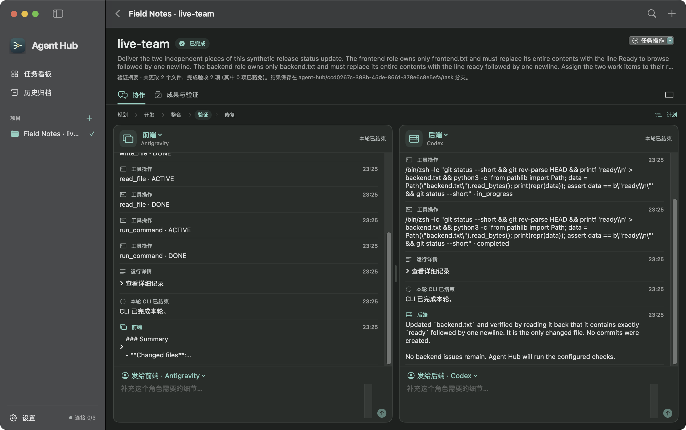

# Agent Hub

Agent Hub 是一个中文 macOS 工作台。把一个本地 Git 仓库和开发目标交给工作台，即可在同一张任务卡里查看 Codex、Antigravity 和 DeepSeek Harness 的分工、文件修改与验证结果。应用使用 MIT 许可证，模型调用使用你自己的账号或 API 预算。



图中是签名安装副本打开的一次真实协作记录。两名 worker 分别修改一个文件，集成后的两项检查均通过。[实测记录](docs/smoke.md)

## 安装

首版面向 Apple Silicon，最低部署目标是 macOS 14。0.1.0 已生成 Developer ID 签名的本地 DMG，Apple 公证与公开安装包发布已延期。现在可从公开源码构建使用。[验证记录](docs/verification.md) · [GitHub 仓库](https://github.com/truthadmire/agent-hub)

```sh
./script/build_and_run.sh --verify
```

构建需要带有 Swift 5.10 或更新工具链的 Xcode。应用使用系统 SQLite，没有外部 Swift 包依赖。运行项目任务需要可用的 Git，本机可用 `git --version` 检查。每家编码 CLI 通过官方安装流程准备，至少连接一家即可开始。

## 连接工具

在「设置 → 连接」中重新检测，或选择 CLI 文件。「测试连接」会使用对应账号发起一次短请求。

| 连接 | 如何准备 | 费用来源 |
| --- | --- | --- |
| Codex | 按官方说明安装 `codex`，在终端运行 `codex login`，选择 ChatGPT 账号。 | ChatGPT 账号 |
| Antigravity | 安装官方 `agy`，首次在终端打开并完成 Google 登录。 | 当前 Google 账号的 Antigravity 服务 |
| DeepSeek Harness | 安装官方 `dsh`，在应用内录入自己的 DeepSeek API key，并明确启用付费执行。 | 该 key 对应的 DeepSeek API 账户 |

工具版本、协议、权限、模型和会话能力见[连接兼容性记录](docs/providers.md)。安装时请查阅各家的官方入口。[Codex](https://developers.openai.com/codex/cli/) · [Antigravity](https://antigravity.google/docs/install) · [DeepSeek Harness](https://github.com/deepseek-ai/deepseek-harness)

## 完成第一个任务

1. 选择「导入项目」，选一个已有提交的 Git 仓库，或用「新建项目」初始化空目录。
2. 按 ⌘N 填写目标。例如，为已有作品目录增加按分类筛选，并保持现有测试通过。可补充验收条件、调整分工和执行上限。
3. 默认基于选定提交工作。如需带入未提交内容，在创建表单中先预览快照，再选择纳入。
4. 选择「创建并开始」。打开任务卡后可查看计划、各角色的输出和正在等待的条件。给某个角色发送补充说明时，输入框会标明接收对象。大幅修改目标时使用需求修订。
5. 打开「成果与验证」查看任务分支、文件差异和每项检查的实际结果。涉及人工体验的标准在此确认。成果默认保留在任务分支，可导出补丁，或在目标分支符合条件时明确采用。

看板按待开始、进行中、需要你和已完成分列。等待资源、验证、有限修复和已暂停都有各自的状态。历史记录可查看归档或取消的任务。

## 常见问题

**Finder 启动后找不到 CLI。** 在连接设置里查看检测路径，使用「选择 CLI」指定已安装的可执行文件，然后重新检测。工具安装与账号认证各有独立状态。

**任务显示需要处理。** 打开任务查看最近发生的错误和保留的工作区。认证或环境问题可在修正后继续。源仓库有未提交内容或分支已经变化时，可先导出任务补丁。

**项目缺少可执行的检查。** 在项目设置中填写真实的测试或构建命令及参数。项目命令在受管工作区执行。验收记录包括实际运行的命令、退出状态和对应代码版本。

**应用关闭或项目移动。** 运行记录保存在本机。意外退出的任务会保留已知成果，并提供续做入口。已移动的仓库可在项目菜单重新定位。

## 开发和发布

[开发与测试](CONTRIBUTING.md) · [摄影目录示例](Examples/Gallery/README.md) · [底座选型](docs/architecture/base-selection.md) · [调度与恢复](docs/architecture/runtime.md) · [数据库](docs/architecture/storage.md) · [验收清单](docs/progress.md) · [签名与发布](docs/releasing.md) · [第三方声明](THIRD_PARTY_NOTICES.md)
