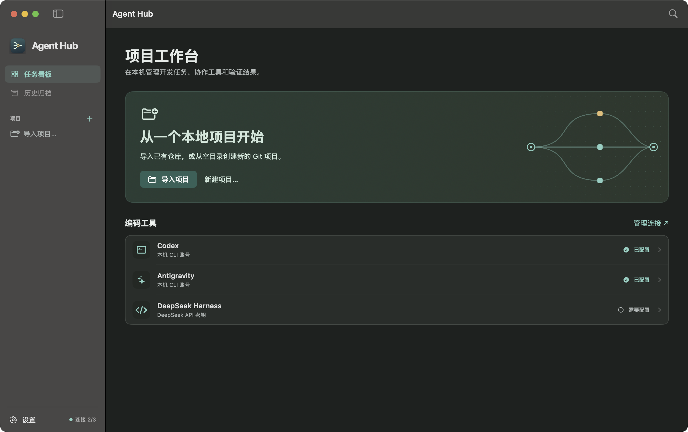

# 原生桌面验收

桌面脚本对指定的 `org.agenthub.desktop` 应用包执行 XCTest UI 测试。运行前请退出其他 Agent Hub 实例。脚本新建临时 Git 仓库、数据库和偏好设置，创建任务时选用“创建并待开始”。Xcode、XcodeGen、已登录的图形会话以及可用的 UI 测试权限是运行条件。

```sh
scripts/ui-smoke.sh '/path/to/Agent Hub.app' /tmp/agent-hub-desktop-evidence
```

最后一个参数须为新的目录。目录内的 PNG 由测试代码针对 Agent Hub 窗口采集，`desktop.xcresult` 保存 XCTest 的步骤与断言。测试不会发送模型请求。通过应用执行的真实模型任务、独立的 CLI 检查和用于双角色场景的模拟数据应分别记录。

## 运行环境

2026-11-26（新加坡），Apple Silicon，macOS 26.6.2（25G83），Xcode 27.0（27A266a），XcodeGen 2.44.1。独立 UI 测试目标通过 `xcodebuild build-for-testing` 编译。辅助功能和截屏权限已通过只读预检。构建运行器本身不代表应用交互已经通过。

## 已观察的原生行为

签名方式为 ad-hoc 的 0.1.0（1）arm64 Debug 应用包使用 LaunchServices 在 Apple M1 Pro、16 GiB 内存的机器上冷启动。使用全新隔离数据库，启动环境的 PATH 仅包含系统目录。单次测量从发送打开请求到读到该 PID 第一个 AXWindow 为 **1.917 秒**。首次启动后第 14 秒，`ps` 对 Agent Hub 主进程的单点读数为 **106,368 KiB RSS，0.0% CPU**。外部 CLI 和测试进程不计入该读数。欢迎页实际呈现两个已配置的连接（Codex、Antigravity）和一个需要配置的连接（DeepSeek Harness）。开发机已装 CLI，此项没有覆盖全新无 CLI 的操作系统环境。


